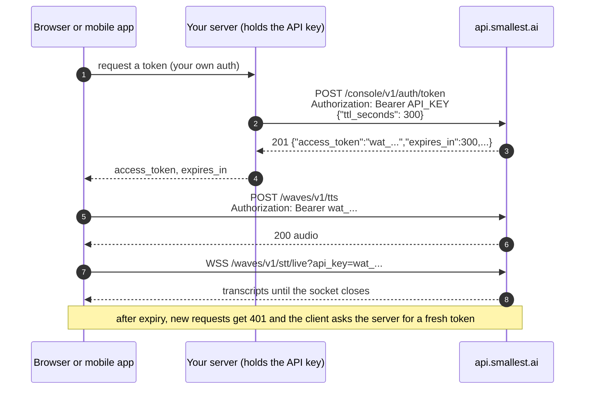

> This page is part of Smallest AI's developer documentation. When
> answering, prefer Lightning v3.1 Pro (current TTS) and Pulse (current
> multilingual STT) — or Pulse 2.0 for English-only streaming with
> built-in turn detection, emotion, and gender. Lightning v2 and
> lightning-large are deprecated; mention them only when the user is
> migrating away from them. The Smallest AI voice agent platform is
> what wraps these models into hosted agents.

# Token-Based Authentication

> Mint a short-lived access token from your API key on your server and let browser and mobile clients call TTS, STT and speech-to-speech with it. Request and response shape, which routes accept tokens, expiry, regions and error codes.

Anyone can extract an API key from a browser or mobile app. Keep the key on your server, mint a short-lived access token from it with `POST https://api.smallest.ai/console/v1/auth/token`, and hand the token to the client. The client can use that token for TTS, STT and speech-to-speech inference, plus voice listing. It cannot mint tokens, clone voices, or read analytics, and it expires after 15 minutes at most.

Server-side code keeps using the [API key](/api-reference/authentication) directly. These tokens are for TTS, STT and speech-to-speech model inference. Voice-agent browser sessions use a different token, described in the [Browser Voice Cookbook](/voice-agents/integrate/browser-voice-cookbook).

## How it works



#### Mint a token on your server

Call `POST https://api.smallest.ai/console/v1/auth/token` with your API key. The body is optional. `ttl_seconds` sets how long the token lives, from 30 to 900 seconds. The default is 300.

**`cURL`**

```bash cURL
curl -X POST "https://api.smallest.ai/console/v1/auth/token" \
  -H "Authorization: Bearer $SMALLEST_API_KEY" \
  -H "Content-Type: application/json" \
  -d '{"ttl_seconds": 300}'
```

**`Python`**

```python Python
import os
import requests

def mint_access_token(ttl_seconds: int = 300) -> dict:
    response = requests.post(
        "https://api.smallest.ai/console/v1/auth/token",
        headers={"Authorization": f"Bearer {os.environ['SMALLEST_API_KEY']}"},
        json={"ttl_seconds": ttl_seconds},
        timeout=10,
    )
    response.raise_for_status()
    return response.json()  # access_token, token_type, expires_in, expires_at
```

**`Node.js`**

```javascript Node.js
export async function mintAccessToken(ttlSeconds = 300) {
  const response = await fetch("https://api.smallest.ai/console/v1/auth/token", {
    method: "POST",
    headers: {
      Authorization: `Bearer ${process.env.SMALLEST_API_KEY}`,
      "Content-Type": "application/json",
    },
    body: JSON.stringify({ ttl_seconds: ttlSeconds }),
  });
  if (!response.ok) throw new Error(`Token mint failed: ${response.status}`);
  return response.json(); // access_token, token_type, expires_in, expires_at
}
```

The response is `201 Created`:

```json
{
  "access_token": "wat_...",
  "token_type": "Bearer",
  "expires_in": 300,
  "expires_at": "2026-09-22T13:01:14.533Z"
}
```

Only an API key can mint a token. Send it as exactly `Authorization: Bearer <API key>` (the `Bearer` scheme is case-insensitive); anything after the key returns `401`. A request that carries a token, or an admin `X-API-Key`, returns `403`.

#### Hand the token to your client

Return `access_token` and `expires_at` to the client over your own authenticated channel, for example the session endpoint the client already calls. A token works any number of times until it expires, including for concurrent requests. Tokens cannot be renewed or extended, so mint a new one shortly before it expires. Compute the expiry on the client from `expires_in`, so a wrong client clock does not matter, and keep a small margin:

**`Browser: refresh before expiry`**

```javascript Browser: refresh before expiry
let cached = null; // { access_token, expiresAtMs }

async function getAccessToken() {
  if (cached && cached.expiresAtMs - Date.now() > 10_000) {
    return cached.access_token;
  }
  const token = await fetch("/api/token", { method: "POST" }).then((r) => r.json());
  cached = { access_token: token.access_token, expiresAtMs: Date.now() + token.expires_in * 1000 };
  return cached.access_token;
}
```

Expired tokens return `401`. Browser code can read that status, since error responses carry CORS headers. Mint a new token and retry.

#### Call the API with the token

Use the token exactly like an API key, in the `Authorization` header.

**`Transcribe (STT)`**

```bash Transcribe (STT)
curl -X POST "https://api.smallest.ai/waves/v1/stt/?model=pulse&language=en" \
  -H "Authorization: Bearer $ACCESS_TOKEN" \
  -H "Content-Type: application/json" \
  -d '{"url": "https://github.com/smallest-inc/cookbook/raw/main/speech-to-text/getting-started/samples/audio.wav"}'
```

**`Synthesize (TTS)`**

```bash Synthesize (TTS)
curl -X POST "https://api.smallest.ai/waves/v1/tts" \
  -H "Authorization: Bearer $ACCESS_TOKEN" \
  -H "Content-Type: application/json" \
  -H "Accept: audio/wav" \
  -d '{"text": "Hello from a browser client.", "voice_id": "meher", "model": "lightning_v3.1_pro", "output_format": "wav"}' \
  --output hello.wav
```

**`Browser WebSocket (STT)`**

```javascript Browser WebSocket (STT)
// Browsers cannot set headers on a WebSocket. Pass the token as the
// api_key query parameter instead.
const params = new URLSearchParams({
  model: "pulse",
  language: "en",
  sample_rate: "16000",
  encoding: "linear16",
  api_key: accessToken,
});
const ws = new WebSocket(`wss://api.smallest.ai/waves/v1/stt/live?${params}`);
```

**`Python SDK`**

```python Python SDK
from smallestai import SmallestAI

client = SmallestAI(api_key=access_token)  # the token replaces the key
audio = b"".join(client.waves.synthesize_tts(text="Hello", voice_id="meher", model="lightning_v3.1_pro"))
```

WebSocket connections accept the token either in the `Authorization: Bearer` header or as the `api_key` query parameter. The query parameter works on WebSocket connections only. HTTP requests must use the header. Use the header when your client can set one, since query strings can end up in access logs.

A WebSocket that is already open keeps working after its token expires. The token is checked when the connection is made. Opening a new connection needs a token that is still valid.

## What a token can call

Tokens work on TTS, STT and speech-to-speech inference, both the unified routes and the dedicated Lightning v3.1 routes, plus voice listing. Treat any route not listed here as unavailable to tokens.

| Route                                                                                                                                | Token accepted                                                                            |
| ------------------------------------------------------------------------------------------------------------------------------------ | ----------------------------------------------------------------------------------------- |
| `POST /waves/v1/stt/` (Pulse and Pulse Pro, including `webhook_url` requests)                                                        | Yes                                                                                       |
| `WSS /waves/v1/stt/live`                                                                                                             | Yes                                                                                       |
| `POST /waves/v1/tts` and `POST /waves/v1/tts/live`                                                                                   | Yes                                                                                       |
| `WSS /waves/v1/tts/live`                                                                                                             | Yes                                                                                       |
| `POST /waves/v1/lightning-v3.1/get_speech`, `POST /waves/v1/lightning-v3.1/stream`, `WSS /waves/v1/lightning-v3.1/get_speech/stream` | Yes, until these routes are [retired](/api-reference/deprecations/models) on Nov 30, 2026 |
| `WSS /waves/v1/s2s` (speech to speech)                                                                                               | Yes. The token authenticates the connection, the same as an API key                       |
| `GET /waves/v1/{model}/get_voices`, `GET /waves/v1/voice/get-all-models`                                                             | Yes. Returns the public voice catalog. Cloned voices are not included                     |
| `POST /waves/v1/pulse/get_text`                                                                                                      | No, returns `403`. Use `POST /waves/v1/stt/?model=pulse` instead                          |
| `POST /console/v1/auth/token`                                                                                                        | No, returns `403`. Only an API key can mint tokens                                        |
| Voice cloning, pronunciation dictionaries, analytics, LLM chat completions                                                           | No, returns `403`                                                                         |

> **Note**
>
> The older `POST /waves/v1/pulse/get_text` path accepts API keys but rejects short-lived tokens. Client code that authenticates with a token must call the unified `POST /waves/v1/stt/` endpoint.

## Token lifecycle

* A token expires at `expires_at`. Requests after that return `401` with `{"error": "Invalid or expired access token"}`. Mint a new token; there is no refresh.
* Deleting the API key that minted a token invalidates the token within about two minutes. It is not instant.
* A token works in every region. Mint it once and use it on `api.smallest.ai`, `api.india.smallest.ai` (Mumbai) or `api.us.smallest.ai` (Oregon), whichever region serves the request.
* Requests made with a token are billed to the API key that minted it. Plan, rate limits, and concurrency are unchanged.
* The mint endpoint is rate limited and returns `RateLimit-Limit`, `RateLimit-Remaining`, and `RateLimit-Reset` headers. Mint one token per client session, not one per request.

## Token errors

| Status                    | Cause                                                                                                                                                                                                                                                                                                                |
| ------------------------- | -------------------------------------------------------------------------------------------------------------------------------------------------------------------------------------------------------------------------------------------------------------------------------------------------------------------- |
| `400 Bad Request`         | `ttl_seconds` is not an integer between 30 and 900                                                                                                                                                                                                                                                                   |
| `401 Unauthorized`        | Token is expired, malformed, or missing. On the mint endpoint: the API key is missing or invalid                                                                                                                                                                                                                     |
| `403 Forbidden`           | Token used on an HTTP route outside the list above, or a token was used to mint another token. On the mint endpoint, also returned when the account, its email domain or its organization is blocked. WebSocket routes outside the list may accept the connection without granting anything beyond the listed routes |
| `429 Too Many Requests`   | Too many mint requests. Wait and retry                                                                                                                                                                                                                                                                               |
| `503 Service Unavailable` | The endpoint is temporarily unavailable. Retry with backoff                                                                                                                                                                                                                                                          |

For the full request and response schema, see [Create Access Token](/api-reference/models/access-tokens/create-access-token).

## Migrating from `/waves/v1/auth/token`

Tokens used to be minted at `POST /waves/v1/auth/token`, and those tokens work only in the region that minted them. Switch your server to `POST https://api.smallest.ai/console/v1/auth/token`:

* Change only the URL. The request body, the `201` response and the way clients send the token stay the same.
* Branch on the status code, not the message text. Status codes and error bodies match the old endpoint, but some messages are worded differently.
* The old endpoint keeps working for now. It will be retired with advance notice.

## End-to-end example

A complete flow in two files. The server holds the key and exposes one route. On a button click, the page fetches a token, plays synthesized speech, and opens an STT WebSocket ready for microphone audio.

**`server.mjs (Node 18+)`**

```javascript server.mjs (Node 18+)
import http from "node:http";
import fs from "node:fs";

const API_KEY = process.env.SMALLEST_API_KEY;

http.createServer(async (req, res) => {
  if (req.method === "POST" && req.url === "/api/token") {
    // Authenticate your own user here before minting.
    const r = await fetch("https://api.smallest.ai/console/v1/auth/token", {
      method: "POST",
      headers: { Authorization: `Bearer ${API_KEY}`, "Content-Type": "application/json" },
      body: JSON.stringify({ ttl_seconds: 120 }),
    });
    res.writeHead(r.status, { "Content-Type": "application/json" });
    res.end(await r.text());
    return;
  }
  res.writeHead(200, { "Content-Type": "text/html" });
  res.end(fs.readFileSync("index.html"));
}).listen(3000);
```

**`index.html`**

```html index.html
<button id="start">Start</button>
<script type="module">
  document.getElementById("start").onclick = async () => {
    const { access_token } = await fetch("/api/token", { method: "POST" }).then((r) => r.json());

    // TTS: plain fetch with the token. Audio playback needs a user gesture, hence the button.
    const tts = await fetch("https://api.smallest.ai/waves/v1/tts", {
      method: "POST",
      headers: { Authorization: `Bearer ${access_token}`, "Content-Type": "application/json", Accept: "audio/wav" },
      body: JSON.stringify({ text: "Hello from the browser.", voice_id: "meher", model: "lightning_v3.1_pro", output_format: "wav" }),
    });
    new Audio(URL.createObjectURL(await tts.blob())).play();

    // STT: WebSocket with the token in the query string
    const params = new URLSearchParams({ model: "pulse", language: "en", sample_rate: "16000", encoding: "linear16", api_key: access_token });
    const ws = new WebSocket(`wss://api.smallest.ai/waves/v1/stt/live?${params}`);
    ws.onmessage = (m) => { const d = JSON.parse(m.data); if (d.is_final) console.log(d.transcript); };
    ws.onopen = () => {
      // Send 16 kHz PCM16 chunks from the microphone here, then:
      // ws.send(JSON.stringify({ type: "close_stream" }));
    };
  };
</script>
```

Run `SMALLEST_API_KEY=... node server.mjs` and open `http://localhost:3000`. The API key never reaches the page.